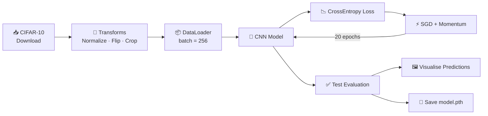
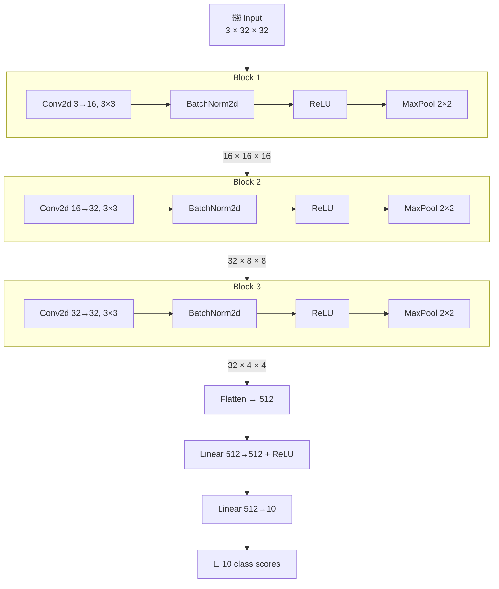
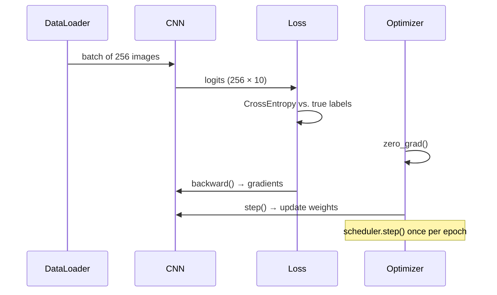

<div align="center">

# 🧠 CNN Image Classifier — CIFAR-10

**A lightweight Convolutional Neural Network built from scratch in PyTorch that teaches itself to recognise 10 everyday object classes from tiny 32×32 colour images.**


[📌 Overview](#-overview) •
[🗂 Dataset](#-dataset--cifar-10) •
[🏗 Architecture](#-model-architecture) •
[⚙️ Training](#%EF%B8%8F-training-setup) •
[📊 Results](#-results) •
[🔍 Predictions](#-sample-predictions) •
[🧩 Code Walkthrough](#-code-walkthrough)

</div>

---

## 📌 Overview

This project trains a **3-block CNN** on the **CIFAR-10** dataset end-to-end inside a single notebook ([CNNimageclassifyer.ipynb](CNNimageclassifyer.ipynb)). The pipeline covers everything from data loading and augmentation to training, evaluation, visualisation and exporting the trained weights.

| 🏁 Stage | What happens |
|---|---|
| **1. Load** | CIFAR-10 is downloaded automatically via `torchvision.datasets` |
| **2. Augment** | Images are normalised, randomly flipped and randomly cropped |
| **3. Build** | A compact CNN with 3 Conv-BN-ReLU-Pool blocks + 2 fully connected layers |
| **4. Train** | 20 epochs with SGD + Momentum and a StepLR scheduler |
| **5. Evaluate** | Accuracy is measured on the 10,000-image test set |
| **6. Visualise** | Training loss curve + predicted vs. actual labels on real images |
| **7. Export** | Trained weights saved as `model.pth` |



---

## 🗂 Dataset — CIFAR-10

CIFAR-10 contains **60,000 colour images (32×32 px)** split across **10 balanced classes**.

| Split | Images |
|---|---|
| 🏋️ Training | 50,000 |
| 🧪 Testing | 10,000 |

<table>
<tr>
<td align="center">✈️<br/><b>airplane</b></td>
<td align="center">🚗<br/><b>automobile</b></td>
<td align="center">🐦<br/><b>bird</b></td>
<td align="center">🐱<br/><b>cat</b></td>
<td align="center">🦌<br/><b>deer</b></td>
</tr>
<tr>
<td align="center">🐶<br/><b>dog</b></td>
<td align="center">🐸<br/><b>frog</b></td>
<td align="center">🐴<br/><b>horse</b></td>
<td align="center">🚢<br/><b>ship</b></td>
<td align="center">🚚<br/><b>truck</b></td>
</tr>
</table>

### 🎨 Preprocessing & Augmentation

```python
transform = transforms.Compose([
    transforms.ToTensor(),                                   # PIL → Tensor [0, 1]
    transforms.Normalize((0.5, 0.5, 0.5), (0.5, 0.5, 0.5)),  # → range [-1, 1]
    transforms.RandomHorizontalFlip(),                       # mirror images 50% of the time
    transforms.RandomCrop(32, padding=4)                     # pad 4px and crop back to 32×32
])
```

<details>
<summary><b>💡 Why augmentation? (click to expand)</b></summary>

<br/>

- **RandomHorizontalFlip** — a cat facing left is still a cat facing right. This effectively doubles the variety of training samples.
- **RandomCrop with padding** — shifts the object slightly within the frame, teaching the model to be **translation-invariant**.
- **Normalize** — centres pixel values around zero, which helps gradients flow smoothly and speeds up convergence.

</details>

---

## 🏗 Model Architecture

A compact, efficient CNN with **three convolutional blocks** followed by a **two-layer classifier head**.



<details>
<summary><b>📐 Layer-by-layer breakdown & parameter count (click to expand)</b></summary>

<br/>

| # | Layer | Output Shape | Parameters |
|---|---|---|---:|
| 0 | Input | 3 × 32 × 32 | – |
| 1 | Conv2d (3→16, k=3, p=1) | 16 × 32 × 32 | 448 |
| 2 | BatchNorm2d (16) | 16 × 32 × 32 | 32 |
| 3 | ReLU + MaxPool2d (2) | 16 × 16 × 16 | – |
| 4 | Conv2d (16→32, k=3, p=1) | 32 × 16 × 16 | 4,640 |
| 5 | BatchNorm2d (32) | 32 × 16 × 16 | 64 |
| 6 | ReLU + MaxPool2d (2) | 32 × 8 × 8 | – |
| 7 | Conv2d (32→32, k=3, p=1) | 32 × 8 × 8 | 9,248 |
| 8 | BatchNorm2d (32) | 32 × 8 × 8 | 64 |
| 9 | ReLU + MaxPool2d (2) | 32 × 4 × 4 | – |
| 10 | Flatten | 512 | – |
| 11 | Linear (512→512) + ReLU | 512 | 262,656 |
| 12 | Linear (512→10) | 10 | 5,130 |
| | **Total trainable** | | **≈ 282,282** |

> 🔎 Over **93 %** of the parameters live in the first fully connected layer — the convolutional feature extractor itself is extremely light (~14.5K params).

</details>

<details>
<summary><b>🧪 Why each component? (click to expand)</b></summary>

<br/>

| Component | Role |
|---|---|
| **Conv2d (3×3, padding=1)** | Learns local patterns (edges → textures → object parts) while preserving spatial size |
| **BatchNorm2d** | Stabilises activations, allows higher learning rates and faster training |
| **ReLU** | Adds non-linearity so the network can learn complex mappings |
| **MaxPool2d (2×2)** | Halves spatial size, keeps strongest features, adds small translation invariance |
| **Linear layers** | Combine extracted features into a final class decision |

</details>

---

## ⚙️ Training Setup

| Hyperparameter | Value |
|---|---|
| 🔁 Epochs | `20` |
| 📦 Batch size | `256` |
| 🎯 Loss function | `CrossEntropyLoss` |
| ⚡ Optimizer | `SGD` |
| 📈 Learning rate | `0.01` |
| 🌀 Momentum | `0.9` |
| 🧷 Weight decay | `0` |
| 🗓 LR Scheduler | `StepLR(step_size=20, gamma=0.1)` |
| 🧵 DataLoader workers | `2` |

```python
optimizer = torch.optim.SGD(model.parameters(), lr=0.01, momentum=0.9, weight_decay=0)
scheduler = torch.optim.lr_scheduler.StepLR(optimizer, step_size=20, gamma=0.1)
```

<details>
<summary><b>🔄 What happens in one training step? (click to expand)</b></summary>

<br/>



</details>

---

## 📊 Results

<div align="center">

| Metric | Score |
|:---:|:---:|
| 🏋️ **Training Accuracy** (final epoch) | **77.89 %** |
| 🧪 **Test Accuracy** | **76.36 %** |
| 📉 **Final Training Loss** | **0.6242** |
| 📏 **Train–Test Gap** | **~1.5 %** |

</div>

> ✅ The tiny gap between training and test accuracy shows the model **generalises well** — the augmentation and BatchNorm are doing their job and there's no sign of overfitting.

```
Accuracy  0%        25%        50%        75%       100%
          |----------|----------|----------|----------|
Train     ███████████████████████████████▏            77.89 %
Test      ██████████████████████████████▌             76.36 %
Random    ████▏                                       10.00 %
```

### 📉 Training Loss Curve

<div align="center">

</div>

The loss drops steadily across all 20 epochs, showing stable optimisation with SGD + momentum.

---

## 🔍 Sample Predictions

<div align="center">

</div>

<br/>

| Image | Actual | Predicted | Result |
|:---:|:---:|:---:|:---:|
| 1 | 🐴 horse | 🦌 deer | ❌ |
| 2 | 🐶 dog | 🚚 truck | ❌ |
| 3 | 🚢 ship | 🚢 ship | ✅ |
| 4 | ✈️ airplane | ✈️ airplane | ✅ |
| 5 | 🚢 ship | 🚢 ship | ✅ |

<details>
<summary><b>🤔 Interesting observation (click to expand)</b></summary>

<br/>

Confusing a **horse** with a **deer** is a very "human" mistake — both are brown four-legged animals often photographed on grass or outdoors. At 32×32 resolution, these classes share a lot of visual features, which is why animal classes are typically the hardest in CIFAR-10, while vehicles like **ships** and **airplanes** (with distinctive blue backgrounds of sea and sky) are recognised confidently.

</details>

---

## 🧩 Code Walkthrough

The notebook is organised into clear, sequential cells. Expand any step to see the core code.

<details>
<summary><b>1️⃣ Data loading</b></summary>

```python
train_dataset = torchvision.datasets.CIFAR10(root="./data", train=True,  download=True, transform=transform)
test_dataset  = torchvision.datasets.CIFAR10(root="./data", train=False, download=True, transform=transform)

train_loader = torch.utils.data.DataLoader(train_dataset, batch_size=256, shuffle=True,  num_workers=2)
test_loader  = torch.utils.data.DataLoader(test_dataset,  batch_size=256, shuffle=False)
```
</details>

<details>
<summary><b>2️⃣ Model definition</b></summary>

```python
class CNN(nn.Module):
    def __init__(self):
        super().__init__()
        self.model = nn.Sequential(
            nn.Conv2d(3, 16, 3, padding=1),  nn.BatchNorm2d(16), nn.ReLU(), nn.MaxPool2d(2),
            nn.Conv2d(16, 32, 3, padding=1), nn.BatchNorm2d(32), nn.ReLU(), nn.MaxPool2d(2),
            nn.Conv2d(32, 32, 3, padding=1), nn.BatchNorm2d(32), nn.ReLU(), nn.MaxPool2d(2),
            nn.Flatten(),
            nn.Linear(32 * 4 * 4, 512), nn.ReLU(),
            nn.Linear(512, 10)
        )

    def forward(self, x):
        return self.model(x)
```
</details>

<details>
<summary><b>3️⃣ Training loop</b></summary>

```python
for epoch in range(num_epochs):
    model.train()
    for images, labels in train_loader:
        outputs = model(images)
        loss = criterion(outputs, labels)

        optimizer.zero_grad()
        loss.backward()
        optimizer.step()
    scheduler.step()
```
</details>

<details>
<summary><b>4️⃣ Evaluation</b></summary>

```python
model.eval()
with torch.no_grad():
    for images, labels in test_loader:
        outputs = model(images)
        _, y_pred = torch.max(outputs.data, 1)
        test_acc += (y_pred == labels).sum().item()

print(f"Test set accuracy = {100 * test_acc / len(test_dataset)} %")
```
</details>

<details>
<summary><b>5️⃣ Visualising predictions</b></summary>

```python
names = list(test_dataset.class_to_idx.keys())
y_true_name = [names[y_true[i]] for i in range(5)]
y_pred_name = [names[y_pred[i]] for i in range(5)]

plt.imshow(np.transpose(torchvision.utils.make_grid(images[:5], normalize=True, padding=1).numpy(), (1, 2, 0)))
plt.title(f"Actual labels: {y_true_name}, Predicted labels: {y_pred_name}")
plt.axis("off")
plt.show()
```
</details>

<details>
<summary><b>6️⃣ Saving the model</b></summary>

```python
torch.save(model.state_dict(), "model.pth")

from google.colab import files
files.download("model.pth")
```

To reuse the trained weights later:

```python
model = CNN()
model.load_state_dict(torch.load("model.pth"))
model.eval()
```
</details>

---

## 🧰 Tech Stack

| Tool | Purpose |
|---|---|
| 🔥 **PyTorch** | Model building, training and inference |
| 🖼 **Torchvision** | CIFAR-10 dataset, transforms and image grid utilities |
| 📊 **Matplotlib** | Loss curve and prediction visualisation |
| 🔢 **NumPy** | Image tensor transposition for plotting |
| ☁️ **Google Colab** | Training environment and model export |

---

## 📁 Project Structure

```
📦 CNN-Image-Classifier
 ┣ 📓 CNNimageclassifyer.ipynb   # Full pipeline: data → model → train → evaluate → export
 ┣ 📂 assets
 ┃ ┣ 🖼 training_loss.png        # Loss curve over 20 epochs
 ┃ ┗ 🖼 predictions.png          # Actual vs predicted sample images
 ┣ 💾 model.pth                  # Trained weights (generated after training)
 ┗ 📄 README.md
```

---

## 🧠 Key Takeaways

- [x] Built a CNN **from scratch** — no pretrained backbones
- [x] Reached **76.36 % test accuracy** with only **~282K parameters**
- [x] Used **data augmentation** and **Batch Normalisation** for strong generalisation
- [x] Minimal **train–test gap (~1.5 %)** → no overfitting
- [x] Exported reusable weights in standard PyTorch `.pth` format

---

<div align="center">

### ⭐ If you found this project useful, give it a star!

*Built with ❤️ and PyTorch*

</div>
